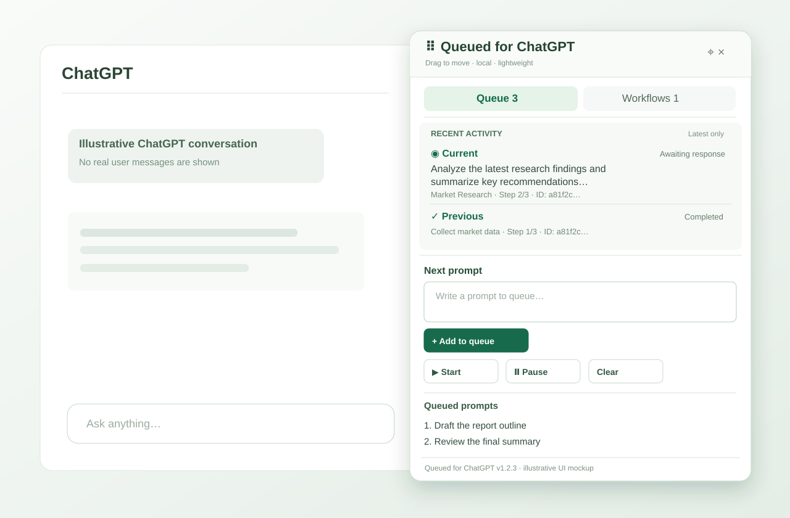
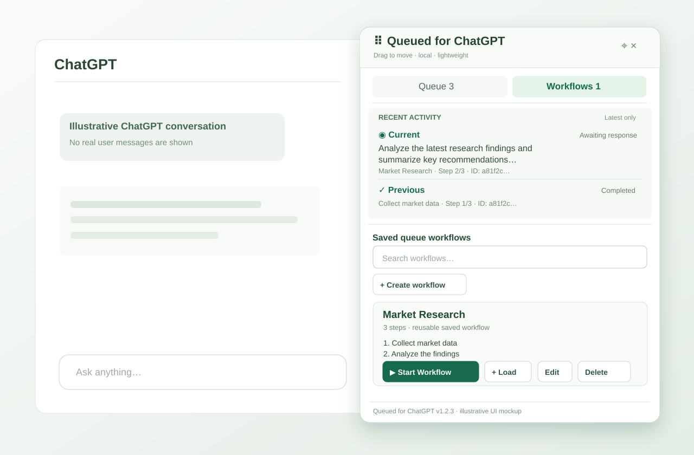

# Queued for ChatGPT v1.2.3 — Recent Queue Activity

An unofficial, independently written, lightweight Chrome / Chromebook extension for sequential ChatGPT prompts and reusable **Saved Queue Workflows**. No Superpower dependency, login, subscription, or cloud server.

**[⬇ Download v1.2.3](https://github.com/helobym/queued-for-chatgpt/releases/tag/v1.2.3)** — official GitHub Release with a ready-to-extract Chrome extension ZIP, installation notes, and SHA-256 checksum. Source code is also available through **Code → Download ZIP**.

**New in v1.2.3:** The floating panel shows **Current** (a prompt being prepared, sent, or awaited) and **Previous** (the last confirmed completed prompt) without scrolling through ChatGPT. Saved workflow steps retain their workflow name, ID and step position. Only one short completed-prompt preview is retained per conversation in local browser storage.

**New in v1.2.2:** Each saved workflow now has both **▶ Start Workflow** and **+ Load**. **Load** appends its steps to the end of the current conversation queue without starting a paused queue. If the queue is already running, the new steps run automatically after the existing queued prompts. It does not interrupt, reorder, or restart the active prompt.

**Testing release.** The automated checks use simulated ChatGPT pages. Compatibility with your live ChatGPT account and Chromebook memory consumption are not yet verified.

## Installation (Chrome / Chromebook)

Queued for ChatGPT is distributed from **GitHub**, not the Chrome Web Store. Install it as an **unpacked extension** in Google Chrome; you do not need ChromeOS Developer Mode or a Chrome Web Store account.

1. Open the [v1.2.3 GitHub Release](https://github.com/helobym/queued-for-chatgpt/releases/tag/v1.2.3), expand **Assets**, and download **`queued-for-chatgpt-v1.2.3.zip`**. Unlike the source archive, this ZIP contains extension files directly at its root.
2. Open the downloaded ZIP in your computer's file manager (the **Files** app on a Chromebook) and **extract/unzip it** into a permanent location.
3. Open the extracted folder and make sure you can see **`manifest.json`** alongside `content.js`, `background.js` and the `icons` folder. Keep the extracted files together.
4. In Chrome, enter **`chrome://extensions`** in the address bar.
5. Turn on **Developer mode** in the top-right corner of the Extensions page, then choose **Load unpacked**.
6. Select the **extracted folder containing `manifest.json`** — **not** the ZIP itself, the `screenshots` folder, or the `tests` folder.
7. Check that **Queued for ChatGPT** appears in your extensions list as **version 1.2.3**.
8. Open or refresh [ChatGPT](https://chatgpt.com/). Look for the floating **☷ Queue** button near the bottom-right of the page. Click it to open Queue or Workflows.

**First test:** Add two harmless prompts to the queue, click **Start**, and confirm that the next prompt is sent only after the prior response completes. Alternatively, create a saved workflow and click **▶ Start Workflow**. The extension runs on `chatgpt.com` only.

**Notes:** An unpacked extension loads from its folder, so **do not delete or move that folder** after installation. Changes from GitHub **do not auto-install**; update manually using the steps below. If you use a school/work-managed Chromebook, your administrator may block Developer mode or unpacked extensions. If the floating button doesn't appear, verify the extension is enabled, then refresh the ChatGPT tab and check **Errors** on `chrome://extensions`.

## Screenshots

Both screenshots below are **illustrative v1.2.3 interface mockups** showing the compact Recent Activity strip shared by Queue and Workflows. They are not live ChatGPT captures and contain no real conversation data. Older screenshots remain in `screenshots/` for reference.

### Queue

### Saved Queue Workflows

## What changed in v1.2.3

- Added **Recent activity** beneath Queue / Workflows showing the current in-flight prompt and the last completed prompt.
- Preserves workflow name, ID and step position on queued steps, including when using Load during another running queue.
- Stores only one bounded completed-prompt preview per conversation; uncertain sends and retries do not overwrite it.
- Activity persists across reloads and new-chat migration, with conservative status labels for paused or remotely controlled queues.
- **Clear** still clears pending prompts, not the last completed preview; uninstalling removes local extension data.

## What changed in v1.2.2

- **+ Load** is available beside **▶ Start Workflow**. Load appends all steps in order without activating or restarting a stopped queue.
- While a queue is running, Load adds the workflow behind existing prompts; the current sender continues automatically through the new steps.
- Loading respects the 100-prompt cap, is atomic and retry-safe, and preserves in-flight prompt status.
- The runner waits for a Load already in progress before declaring a local queue complete.
- Updated tests and release packaging, installation instructions, and manual upgrade checklist.

## What changed in v1.2.1 from v1.2.0

- **▶ Start Workflow** replaces **+ Load to Queue** on each saved workflow.
- Clicking once **appends all workflow steps to the current conversation's queue and starts sending immediately**. It no longer requires a second click on the main Queue **Start** button.
- It works in both **New Chat** and existing ChatGPT conversations. On New Chat, the first prompt creates the conversation and the remaining workflow steps continue after a confirmed reply.
- If the current chat already has pending prompts, a confirmation explains that **existing prompts send first** and workflow steps follow. Cancelling changes nothing.
- The extension acquires the conversation's exclusive sender lock **before appending** workflow steps. If another tab owns it, nothing is appended or sent.
- If the queue contains a message whose send or response is uncertain, Start Workflow stops and asks you to review that prompt first.
- If the queue is already running in this tab, pause it before starting another workflow. Starting the same workflow repeatedly adds additional copies of its steps; be deliberate.
- A workflow is appended all-or-none; insufficient queue capacity prevents adding any steps or starting the queue.
- **Normal Queue Start remains available**, including for manually typed prompts. No other queue, storage, workflow editing, multi-tab, or floating-panel behavior was intentionally changed.

## Updating an existing installation

Unpacked extensions **do not update automatically from GitHub**.

1. In **Workflows**, export important saved workflows to a JSON backup before updating. Review any in-flight queue items.
2. Download **`queued-for-chatgpt-v1.2.3.zip`** from the [v1.2.3 GitHub Release](https://github.com/helobym/queued-for-chatgpt/releases/tag/v1.2.3) and extract it.
3. **Keep your existing installed extension folder and extension ID.** Copy the updated extension files and `icons` folder from the newly extracted copy into that **same original folder**, replacing the matching files. Do **not** uninstall the extension or load a second copy from a different folder.
4. Open **`chrome://extensions`**, click **Reload** on the existing Queued for ChatGPT card, and confirm its version.
5. Refresh all ChatGPT tabs to load the new content script.

Changing the extension's ID (for example, by installing from a different folder) can make your old locally stored queues and workflows inaccessible to the new copy. Export backups before upgrading, and check uncertain sends manually to avoid duplicates.

## How to use Load Workflow

1. Open **Workflows** and find the saved workflow you want.
2. Click **+ Load**. All its steps append after the current queued prompts, preserving their order.
3. If the queue is **paused or empty**, Load only prepares the queue. Open **Queue** and click **Start** when you want it to send.
4. If the queue is **already running**, Load does not restart it. The active prompt finishes first, any previously pending prompts run next, and the loaded workflow steps follow automatically.

For example, with prompt **#1 running** and prompt **#2 pending**, loading a two-step workflow adds those steps as **#3** and **#4**. Load may also be used from a second tab for the same conversation: the tab holding the sending lock continues processing the shared queue. A workflow load is all-or-none if the 100-prompt limit would be exceeded.

**Start Workflow** is unchanged: it still appends and immediately starts a stopped queue, and it asks for confirmation when pending prompts already exist. Use Load instead when the queue is already running.

## How to use Start Workflow

1. Open a fresh ChatGPT **New Chat** or an existing conversation.
2. Open the movable **☷ Queue** floating panel, then the **☷ Workflows** tab.
3. Create or select a saved workflow containing at least one prompt.
4. Click **▶ Start Workflow**. The view changes to **Queue** and begins automatic sequential sending.
5. Watch the first run: the next prompt sends only after the previous response is confirmed finished.

**If queued items already exist**, confirm the dialog to send those **before** the saved workflow steps, or cancel and manage the existing queue first. The extension does not silently clear, replace, or reorder existing prompts.

**If the current queue is running**, pause it before clicking a different Start Workflow. If another tab/window is already processing the same chat, the start attempt will be refused without appending. Different conversations may still have independent queues.

## Existing features retained

- New-chat first prompt, sequential auto-send, pause/resume, edit/remove/reorder, conservative receipt/completion checks, safe manual recovery.
- Shared workflow library across browser tabs and windows: save pending queue as workflow, create/edit/reorder/delete workflows, JSON import/export.
- Draggable floating panel, position reset, per-tab position persistence and one current/previous prompt activity strip.
- Old Favorites data remains in legacy storage for separate backup, but the old star/Favorites UI stays removed.
- Manifest V3, vanilla JS, local-only storage, no API key, no telemetry or external backend.

## Safety and limitations

- Auto-send only runs while its ChatGPT tab is active and the page remains available. Background suspension or tab closure may interrupt it.
- The extension does **not** treat a temporarily idle composer as proof of a completed response. Missing confirmation leads to a pause, not an automatic retry or duplicate send.
- If an item is marked sending/awaiting, inspect ChatGPT before using **✓ Done** or **↺ Retry**. Retrying may duplicate a message already sent.
- A composer draft that ChatGPT hasn't sent won't be overwritten. If an existing draft blocks sending, review it and the queued item before resuming.
- Queue limit: 100 prompts; workflow limit: 200 named workflows, maximum 100 steps per workflow. Prompt text and a single short completed-prompt preview per chat are stored in local Chrome extension storage and may contain sensitive data.
- Under-25 MB incremental memory remains a target, not a measurement or guarantee.

## Automated tests

`node --test tests/*.test.js` — automated unit/coordinator/background test suite (includes workflow metadata, recent completion snapshots, and active-queue Load coverage). The GitHub Release workflow runs these tests before publishing the installation archive.

Playwright (installed Chromium, simulated page):

- `tests/smoke_workflows.py` — create/edit then directly start a saved workflow in an existing chat.
- `tests/smoke_workflow_load_during_run.py` — Load while idle does not send; Load while running appends after existing prompts and the active runner processes the new steps.
- `tests/smoke_workflow_new_chat.py` — directly start workflow on New Chat.
- `tests/smoke_workflow_direct_start_safety.py` — three safety cases: existing queue approval, lock refusal, uncertain item.
- `tests/smoke_browser.py`, `tests/smoke_new_chat.py`, `tests/smoke_app_shell.py`, `tests/smoke_draggable_panel.py` — regression scenarios.
- `tests/smoke_app_shell_uncertain.py`, `tests/smoke_first_reply_uncertain.py` — two uncertainty safeguards.

No live-site or Chromebook memory test was possible here. Begin with two harmless prompts in a new chat while watching the first run.

## Privacy policy

Queued for ChatGPT saves queues and workflows locally in your browser and submits prompts to ChatGPT when you start a queue or workflow. See our [Privacy Policy](PRIVACY.md) for details about storage, data sharing, and removal.

## License and ownership

Copyright (c) 2026 **Helobym Networking (Malaysia)**. This project is open source under the **[MIT License](LICENSE)**. You may use, modify, and redistribute the code, including commercially, provided the copyright and license notices remain intact.

The project is independently developed; no Superpower for ChatGPT code or assets were reused. It is unofficial and not affiliated with or endorsed by OpenAI or Superpower. Third-party trademarks are not licensed by MIT. Confirm the correct registered legal copyright holder and any necessary contributor rights assignments before publication.
