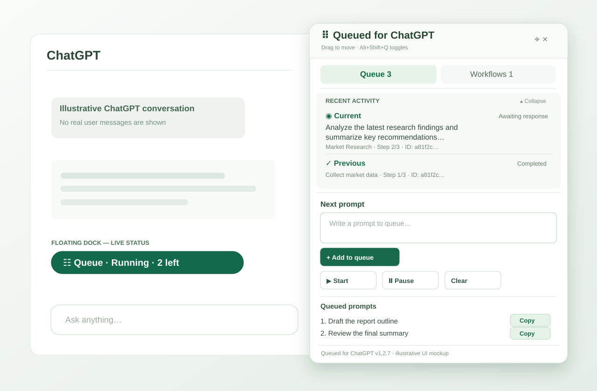
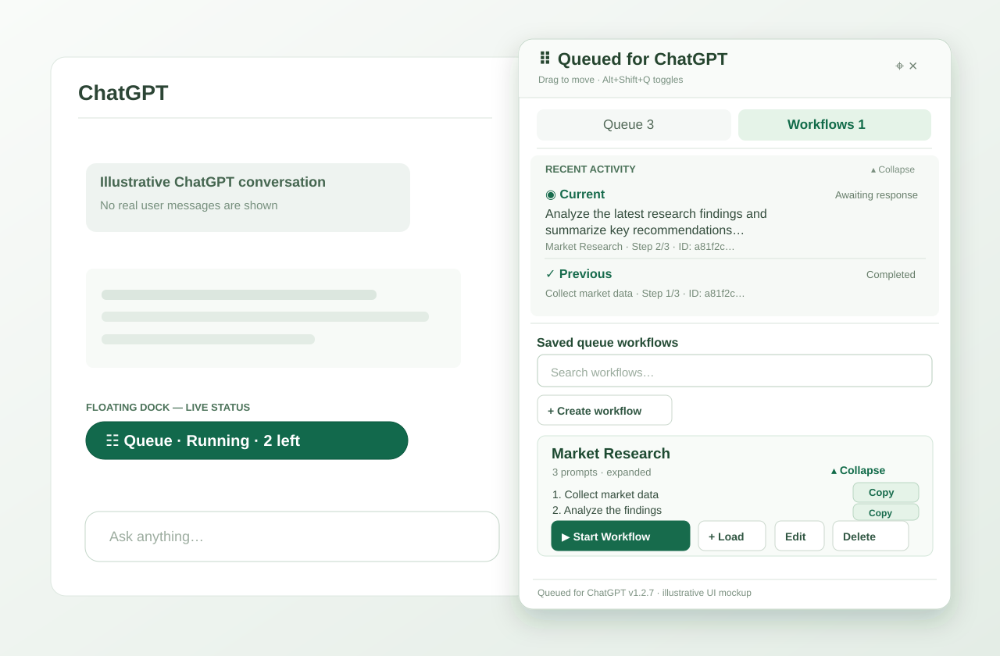

# Queued for ChatGPT v1.2.10 — Lightweight Notification Controls and Audio

An unofficial, independently written, lightweight Chrome / Chromebook extension for sequential ChatGPT prompts and reusable **Saved Queue Workflows**. No Superpower dependency, login, subscription, or cloud server.

**[⬇ Download v1.2.10](https://github.com/helobym/queued-for-chatgpt/releases/tag/v1.2.10)** — official GitHub Release with a ready-to-extract Chrome extension ZIP, installation notes, and SHA-256 checksum. Source code is also available through **Code → Download ZIP**.

**New in v1.2.10:** Clear ON/OFF notification switches with save feedback, adjustable 0–100% custom sound volume and Play Once / 1–60-second duration. A short sound preview and silent test notification help diagnose ChromeOS delivery. Original tones reuse at most two audio-node pairs, with no new background scheduler, external assets or permissions.

**New in v1.2.9:** Introduced compact workflow chevrons and the in-panel Notification Settings view with locally generated custom chimes.

**New in v1.2.8:** Receive one Chrome desktop notification when a run completes after verified responses or automatically stops because it needs attention. User Pause and manual Stop remain silent. Chrome Memory Saver discards generate best-effort interruption alerts; clicking a notification returns to the originating ChatGPT tab if it still exists. No server, background polling or prompt/response text is added to notification records. The only new permission is **notifications**.

**New in v1.2.7:** Start Workflow and + Load keep the Workflows page open; **Alt+Shift+Q** toggles the floating panel (reassign at `chrome://extensions/shortcuts`); Recent Activity is collapsed by default and expands on demand. Idle DOM work and hidden-list rendering are reduced without changing sender locks, prompt submission or response-confirmation safeguards.

**New in v1.2.6:** The floating Queue dock now shows live Start/Running/Paused status and the number of prompts still pending, excluding the active prompt. Saved Workflows are collapsed by default, expand to show numbered full prompts, and provide a Copy button on each step. No new permissions, background polling, or storage migration required.

**New in v1.2.5:** ChatGPT Project landing pages now support **+ Load**, **▶ Start Workflow**, and normal Queue Start. Temporary queue identifiers are separated between Projects, and queued prompts have a **Copy** button (including sending and awaiting-response prompts). No new permissions or queue data migration required.

**New in v1.2.4:** Send verification now checks for a genuinely new user turn before moving an item to Awaiting response. An ignored Send click, a re-rendered historical message, or a matching unsent composer draft is no longer treated as confirmed submission. The Send control is selected more carefully. Existing queue/workflow storage and safety recovery remain compatible.

**New in v1.2.3:** The floating panel shows **Current** (a prompt being prepared, sent, or awaited) and **Previous** (the last confirmed completed prompt) without scrolling through ChatGPT. Saved workflow steps retain their workflow name, ID and step position. Only one short completed-prompt preview is retained per conversation in local browser storage.

**New in v1.2.2:** Each saved workflow now has both **▶ Start Workflow** and **+ Load**. **Load** appends its steps to the end of the current conversation queue without starting a paused queue. If the queue is already running, the new steps run automatically after the existing queued prompts. It does not interrupt, reorder, or restart the active prompt.

**Testing release.** Automated checks use simulated ChatGPT pages, not a live ChatGPT account. Compatibility with your live ChatGPT account and Chromebook memory consumption are not yet verified.

## Installation (Chrome / Chromebook)

Queued for ChatGPT is distributed from **GitHub**, not the Chrome Web Store. Install it as an **unpacked extension** in Google Chrome; you do not need ChromeOS Developer Mode or a Chrome Web Store account.

1. Open the [v1.2.10 GitHub Release](https://github.com/helobym/queued-for-chatgpt/releases/tag/v1.2.10), expand **Assets**, and download **`queued-for-chatgpt-v1.2.10.zip`**. Unlike the source archive, this ZIP contains extension files directly at its root.
2. Open the downloaded ZIP in your computer's file manager (the **Files** app on a Chromebook) and **extract/unzip it** into a permanent location.
3. Open the extracted folder and make sure you can see **`manifest.json`** alongside `content.js`, `background.js` and the `icons` folder. Keep the extracted files together.
4. In Chrome, enter **`chrome://extensions`** in the address bar.
5. Turn on **Developer mode** in the top-right corner of the Extensions page, then choose **Load unpacked**.
6. Select the **extracted folder containing `manifest.json`** — **not** the ZIP itself, the `screenshots` folder, or the `tests` folder.
7. Check that **Queued for ChatGPT** appears in your extensions list as **version 1.2.10**.
8. Open or refresh [ChatGPT](https://chatgpt.com/). Look for the floating **☷ Queue** button near the bottom-right of the page. Click it to open Queue or Workflows.

**First test:** Add two harmless prompts to the queue, click **Start**, and confirm that the next prompt is sent only after the prior response completes. Alternatively, create a saved workflow and click **▶ Start Workflow**. The extension runs on `chatgpt.com` only.

**Notes:** An unpacked extension loads from its folder, so **do not delete or move that folder** after installation. Changes from GitHub **do not auto-install**; update manually using the steps below. If you use a school/work-managed Chromebook, your administrator may block Developer mode or unpacked extensions. If the floating button doesn't appear, verify the extension is enabled, then refresh the ChatGPT tab and check **Errors** on `chrome://extensions`.

## Screenshots

Both screenshots below are **illustrative v1.2.7 interface mockups** showing the live dock, workflows and Recent Activity after the user expands it (activity starts collapsed by default). They are not live ChatGPT captures and contain no real conversation data. Older screenshots remain in `screenshots/` for reference.

### Queue

### Saved Queue Workflows

## What changed in v1.2.10

- **Obvious notification switches:** Larger ON/OFF controls for Desktop notifications, Workflow completed and Stopped automatically, with short explanations and immediate Save status or failure recovery.
- **Flexible custom audio:** Choose Play Once or any whole number of seconds from 1 to 60, and set volume from 0% (mute) to 100%. Existing saved duration values remain compatible.
- **Lightweight playback:** Reuse at most two oscillators and gains for each tone, schedule only bounded envelopes, and close the audio context after playback. One active player; no idle polling, background service, audio files or new permissions.
- **Explicit test actions:** Test sound plays a short two-second sample. Test notification requests one silent desktop notification without starting a workflow; OS restrictions still apply.
- **No workflow changes:** Sender locks, prompt safety, completion verification, run-ID deduplication, manual Pause behavior and stored workflows stay unchanged.

## What changed in v1.2.9

- **Compact workflow disclosure:** Each saved workflow name now starts with a small, keyboard-accessible chevron. The full Expand/Collapse action button is removed from its control row; Start Workflow, + Load, Edit, Delete, full prompt details and Copy are unchanged.
- **In-panel Notification Settings:** Click **⚙** beside the reset-position and close controls. Configure desktop notifications, completion/automatic-stop alerts, sounds, duration and visibility. **← Back** returns to the previously selected Queue/Workflows page without resetting expanded workflows.
- **Custom sounds:** System default, Silent, Soft Chime, Double Chime and Alert Beep. Generated locally using Web Audio in an audio-only offscreen extension document, opened only when needed. A **▶ Test sound** button previews one selected custom tone.
- **Bounded audio:** Choose Once, 5, 10 or 20 seconds for custom tones. System Default and Silent do not enable this control. The system decides whether sound actually plays; duration is an upper bound, not guaranteed uninterrupted audio.
- **Visibility choices:** System Default or **Until dismissed (where supported)** via Chrome's `requireInteraction` option. Arbitrary 5/10-second Chrome popup lifetimes are not available.
- **No queue changes:** Settings use a separate `chrome.storage.local` key and synchronize across extension tabs. Sender locks, safe receipt/response checks, queued prompt data and automatic/manual stop semantics remain unchanged.

## What changed in v1.2.8

- **Verified completion alert:** after every automatically verified queued prompt is complete, one desktop notification reports the number of verified prompts and the workflow name when every prompt belongs to the same workflow. Mixed queues are correctly labeled Queue completed.
- **Automatic-stop alert:** if the runner pauses because of a composer problem, unconfirmed Send, incomplete response, storage change or unexpected page change, one attention notification explains the problem. An uncertain prompt is not retried automatically.
- **Manual controls stay silent:** clicking Pause, intentionally stopping a response, or closing a ChatGPT tab does not produce a false completion notification. Load never triggers one on its own.
- **Memory Saver awareness:** the background worker listens for Chrome tab discards and can issue a best-effort interruption alert even when the content script no longer runs. A crash, browser restart or an operating-system notification block still cannot guarantee delivery.
- **Click to return:** clicking a notification selects the originating ChatGPT tab and focuses its window if the tab remains available; the extension never opens a new tab automatically.
- **Lightweight state:** only a run identifier, originating tab ID, start time and bounded workflow label are saved temporarily in `chrome.storage.session`. The extension does not store prompt/assistant text or a persistent notification history. No polling timers, additional DOM observers or external service.

## What changed in v1.2.7

- **Stay in Workflows:** Start Workflow and + Load preserve the selected view, expanded steps, scroll position and search query. Choose Queue manually if you want to inspect or change queued prompts.
- **Native Chrome shortcut:** Alt+Shift+Q opens or closes the floating panel in the active ChatGPT tab; reassign or troubleshoot conflicts at `chrome://extensions/shortcuts`. The shortcut does not start or pause jobs and is not available on unrelated websites.
- **Collapsible Recent Activity:** compact by default, expandable using mouse or keyboard, with Current and Previous prompt previews and workflow attribution. The disclosure state stays while the page is open.
- **Reduced idle overhead:** skip costly assistant-selector examination while idle and defer hidden Queue/Workflows DOM rebuilding. The DOM observer remains installed for ChatGPT route detection; this does not claim an established memory leak or measured RAM savings.
- **Preserved safety:** queue and workflow data schema, Web Locks, safe send receipt verification and response-completion rules remain unchanged.

## What changed in v1.2.6

- The floating Queue dock displays **Running**, **Starting**, **Paused**, **Idle**, **Loading**, and conservative **Check status** / **Unavailable** indications.
- While running, the dock shows the number of **pending prompts left after the current active prompt**. The Queue tab continues showing all queued records; a final active prompt correctly shows **0 left**.
- Saved workflows are **collapsed by default**. Expand any workflow to read its steps individually, and use **Copy** to copy a complete saved prompt without loading, starting, or editing the queue.
- Preserves workflow disclosure across queue activity and avoids unnecessary workflow-list recreation during auto-send.
- Uses only existing local queue data and sender-lock information; no additional permissions, storage migrations, or timer-based polling.
- Added simulated browser regression coverage for workflow disclosure/Copy, dock remaining counts, multi-tab uncertainty, Project navigation, and draggable layouts.

## What changed in v1.2.5

- Recognizes ChatGPT Project landing pages (`/g/g-p-…/project`) as supported New Chat contexts for workflow loading and sequential starts.
- Isolates session-scoped temporary queues by Project, preserving pending work when navigating between Projects and migrating only the source queue after the first confirmed send.
- Revalidates routes before editing or sending, and prevents older asynchronous queue loads from resetting the current page's load state.
- Adds **Copy** on every queued prompt, including sending and awaiting-response items; copies full text without changing queue status or interrupting a workflow.
- Adds simulated-browser coverage for Project navigation, persistence, first-send migration and clipboard failures, plus v1.2.5 ZIP and SHA-256 release packaging.
- Retains the existing storage schema, Web Locks, conservative send and response verification, Saved Workflows, and permissions.

## What changed in v1.2.4

- Prefers ChatGPT's explicit Send controls; rejects ambiguous submit controls and checks the button's disabled state.
- Records a pre-send user-turn baseline and requires evidence of a genuinely new user turn before changing `sending` to `awaiting`.
- Rejects false receipts from re-rendered historical messages or a matching unsent composer draft.
- If a Send click is ignored, the queued prompt stays unresolved for manual review rather than automatically retrying and risking duplicate messages.
- Preserves existing response-completion checks, New Chat handoff, Saved Workflows, Recent Activity, multi-tab locks, and local storage.
- Adds regression coverage for identical consecutive prompts and an ignored Send click with DOM re-rendering.
- No new Chrome permissions, APIs, servers, or telemetry.

## What changed in v1.2.3

- Added **Recent activity** beneath Queue / Workflows showing the current in-flight prompt and the last completed prompt.
- Preserves workflow name, ID and step position on queued steps, including when using Load during another running queue.
- Stores only one bounded completed-prompt preview per conversation; uncertain sends and retries do not overwrite it.
- Activity persists across reloads and new-chat migration, with conservative status labels for paused or remotely controlled queues.
- **Clear** still clears pending prompts, not the last completed preview; uninstalling removes local extension data.

## What changed in v1.2.2

- **+ Load** is available beside **▶ Start Workflow**. Load appends all steps in order without activating or restarting a stopped queue.
- While a queue is running, Load adds the workflow behind existing prompts; the current sender continues automatically through the new steps.
- Loading respects the 100-prompt cap, is atomic and retry-safe, and preserves in-flight prompt status.
- The runner waits for a Load already in progress before declaring a local queue complete.
- Updated tests and release packaging, installation instructions, and manual upgrade checklist.

## What changed in v1.2.1 from v1.2.0

- **▶ Start Workflow** replaces **+ Load to Queue** on each saved workflow.
- Clicking once **appends all workflow steps to the current conversation's queue and starts sending immediately**. It no longer requires a second click on the main Queue **Start** button.
- It works in both **New Chat** and existing ChatGPT conversations. On New Chat, the first prompt creates the conversation and the remaining workflow steps continue after a confirmed reply.
- If the current chat already has pending prompts, a confirmation explains that **existing prompts send first** and workflow steps follow. Cancelling changes nothing.
- The extension acquires the conversation's exclusive sender lock **before appending** workflow steps. If another tab owns it, nothing is appended or sent.
- If the queue contains a message whose send or response is uncertain, Start Workflow stops and asks you to review that prompt first.
- If the queue is already running in this tab, pause it before starting another workflow. Starting the same workflow repeatedly adds additional copies of its steps; be deliberate.
- A workflow is appended all-or-none; insufficient queue capacity prevents adding any steps or starting the queue.
- **Normal Queue Start remains available**, including for manually typed prompts. No other queue, storage, workflow editing, multi-tab, or floating-panel behavior was intentionally changed.

## Updating an existing installation

Unpacked extensions **do not update automatically from GitHub**.

1. In **Workflows**, export important saved workflows to a JSON backup before updating. Review any in-flight queue items.
2. Download **`queued-for-chatgpt-v1.2.10.zip`** from the [v1.2.10 GitHub Release](https://github.com/helobym/queued-for-chatgpt/releases/tag/v1.2.10) and extract it.
3. **Keep your existing installed extension folder and extension ID.** Copy the updated extension files and `icons` folder from the newly extracted copy into that **same original folder**, replacing the matching files. Do **not** uninstall the extension or load a second copy from a different folder.
4. Open **`chrome://extensions`**, click **Reload** on the existing Queued for ChatGPT card, and confirm its version.
5. Refresh all ChatGPT tabs to load the new content script.

Changing the extension's ID (for example, by installing from a different folder) can make your old locally stored queues and workflows inaccessible to the new copy. Export backups before upgrading, and check uncertain sends manually to avoid duplicates.

## How to use Load Workflow

On a ChatGPT Project landing page (`/g/g-p-…/project`), **+ Load** and **▶ Start Workflow** are available just as on ordinary New Chat. Each Project keeps its own pending temporary queue in that browser tab until ChatGPT creates a conversation.

1. Open **Workflows** and find the saved workflow you want.
2. Click **+ Load**. All its steps append after the current queued prompts, preserving their order. You remain on the Workflows page.
3. If the queue is **paused or empty**, Load only prepares the queue. Open **Queue** and click **Start** when you want it to send.
4. If the queue is **already running**, Load does not restart it. The active prompt finishes first, any previously pending prompts run next, and the loaded workflow steps follow automatically.

For example, with prompt **#1 running** and prompt **#2 pending**, loading a two-step workflow adds those steps as **#3** and **#4**. Load may also be used from a second tab for the same conversation: the tab holding the sending lock continues processing the shared queue. A workflow load is all-or-none if the 100-prompt limit would be exceeded.

**Start Workflow** is unchanged: it still appends and immediately starts a stopped queue, and it asks for confirmation when pending prompts already exist. Use Load instead when the queue is already running.

## How to use Start Workflow

1. Open a fresh ChatGPT **New Chat**, a **Project landing page**, or an existing conversation.
2. Open the movable **☷ Queue** floating panel, then the **☷ Workflows** tab.
3. Create or select a saved workflow containing at least one prompt.
4. Click **▶ Start Workflow**. The panel stays on **Workflows** while sequential sending begins; click **Queue** manually to see the list.
5. Watch the first run: the next prompt sends only after the previous response is confirmed finished.

**If queued items already exist**, confirm the dialog to send those **before** the saved workflow steps, or cancel and manage the existing queue first. The extension does not silently clear, replace, or reorder existing prompts.

**If the current queue is running**, pause it before clicking a different Start Workflow. If another tab/window is already processing the same chat, the start attempt will be refused without appending. Different conversations may still have independent queues.

## Live dock, panel shortcut, Recent Activity, expandable workflows, and Copy

The floating **☷ Queue** button shows the active conversation's live status even when the panel is closed. When running, **N left** means N prompts are still pending *after* the active prompt. A final active prompt shows **Running · 0 left** until completion. A queue that is pending but not running shows **Paused · N pending**. **Check status** means an in-flight prompt may be handled in another tab or requires manual review; do not assume it is safe to retry. **Starting** means a sender lock has not yet been confirmed.

Press **Alt+Shift+Q** to open or close the panel. The shortcut is provided by Chrome's Commands API, so it can be changed at `chrome://extensions/shortcuts` if it conflicts or is not assigned. This affects only the active ChatGPT tab's panel, not queue execution.

**Recent Activity** remains a small heading until you choose **Expand**. It then shows Current and Previous previews with workflow name and step information. Click **Collapse** to hide details; closing/reopening the panel or switching Queue/Workflows leaves the disclosure state intact until the page reloads.

On **Workflows**, each saved workflow starts collapsed. Click **Expand** to see all numbered prompts in a scrollable panel; click **Collapse** to hide them. Use **Copy** beside any saved workflow prompt to copy its full text without loading the workflow or changing queue execution. Workflow names and prompt contents are still searchable when collapsed.

On **Queue**, **Copy** remains available for pending, sending or awaiting-response prompts. All Copy actions preserve full text and line breaks, show brief success/failure feedback, and never send, edit, pause, or remove prompts. Clipboard contents may be accessible to other applications on the device.

## Notification Settings and custom sound

Open the floating **☷ Queue** panel and click **⚙ Notification settings**. The Desktop notifications, Workflow completed and Stopped automatically switches show ON/OFF states and a small Saved/Save failed indicator. Choose System Default or Silent, or select a locally generated Soft Chime, Double Chime or Alert Beep. For a custom sound, choose **Play once** or **Custom duration** (a whole number from **1–60 seconds**) and adjust **Custom sound volume** from **0–100%**. **Test sound (2s)** requests a brief audio preview and **Test notification** requests a separate silent desktop notification. The test actions do not send prompts or create workflow completion records.

**Until dismissed** requests a persistent Chrome notification where supported; Chrome/OS may still dismiss it. **Sound duration is not popup duration**, and OS sound/Focus/Do Not Disturb or browser restrictions can suppress audio or notifications entirely. Custom audio uses the `offscreen` permission, opens an audio-only extension context only as needed, and runs a bounded timer there. No ringtone files are downloaded; no text from prompts or AI responses is included in sound instructions.

The same preferences apply across ChatGPT tabs. They do not interrupt the active queue and do not change how many prompts have been verified. Only automatic completion or automatic-interruption events trigger alerts; manual Pause and manual Stop stay silent.

## Desktop notifications

After you click **Start** or **Start Workflow**, the extension monitors the run using its existing conservative send/response verification. When the final response has been verified, Chrome displays **Workflow completed successfully** with the verified prompt count and workflow name, or **Queue completed successfully** when prompts come from different sources.

If the queue stops itself due to an uncertain send, response, composer or storage condition, Chrome instead displays **Workflow stopped — action required** or **Queue stopped — action required**. It never labels uncertain work as successful. Clicking **Pause** or manually stopping ChatGPT's response does not display an alert.

Chrome may suppress notifications because of operating-system settings, Focus/Do Not Disturb, or blocked notification permissions. Chrome Memory Saver can discard the running ChatGPT tab; the extension attempts an interruption notification from the service worker but cannot guarantee delivery after browser closure, crash or extension reload. A tab being discarded is **not** successful workflow completion. Clicking an alert returns to its original ChatGPT tab if it still exists; a closed tab is not reopened.

The extension uses the **notifications** permission alongside its existing **storage** permission. Notification messages contain a bounded workflow name, outcome/reason and verified count (or a discard warning), not complete prompt text or AI responses. Because the workflow name may be visible on your desktop/lock screen, avoid sensitive names if privacy matters.

## Existing features retained

- New-chat first prompt, sequential auto-send, pause/resume, edit/remove/reorder, conservative receipt/completion checks, safe manual recovery.
- Shared workflow library across browser tabs and windows: save pending queue as workflow, create/edit/reorder/delete workflows, JSON import/export.
- Live-status floating dock, draggable panel, position reset, per-tab position persistence, expandable workflows and one current/previous prompt activity strip.
- Old Favorites data remains in legacy storage for separate backup, but the old star/Favorites UI stays removed.
- Manifest V3, vanilla JS, local-only storage, no API key, no telemetry or external backend.

## Safety and limitations

- Auto-send only runs while its ChatGPT tab remains available. A discarded tab may trigger a best-effort interruption alert, but closing the browser or suspending the extension can prevent notification delivery.
- The extension does **not** treat a temporarily idle composer as proof of a completed response. Missing confirmation leads to a pause, not an automatic retry or duplicate send.
- If an item is marked sending/awaiting, inspect ChatGPT before using **✓ Done** or **↺ Retry**. Retrying may duplicate a message already sent.
- A composer draft that ChatGPT hasn't sent won't be overwritten. If an existing draft blocks sending, review it and the queued item before resuming.
- Queue limit: 100 prompts; workflow limit: 200 named workflows, maximum 100 steps per workflow. Prompt text and a single short completed-prompt preview per chat are stored in local Chrome extension storage and may contain sensitive data.
- Under-25 MB incremental memory remains a target, not a measurement or guarantee.

## Automated tests

`node --test tests/*.test.js` — automated unit/coordinator/background test suite (includes workflow metadata, recent completion snapshots, and active-queue Load coverage). The GitHub Release workflow runs these tests and targeted simulated Chromium regressions before publishing the installation archive.

Playwright (installed Chromium, simulated page):

- `tests/smoke_workflows.py` — collapsed/expanded workflows, create/edit and direct start in an existing chat.
- `tests/smoke_workflow_load_during_run.py` — Load while idle does not send; Load while running appends after existing prompts and the active runner processes the new steps.
- `tests/smoke_workflow_new_chat.py` — directly start workflow on New Chat and verify the first prompt is counted exactly once in the completion alert.
- `tests/smoke_notifications.py` — verified completion, automatic send-stop notification, manual Pause silence and notification-click behavior.
- `tests/smoke_v129_settings.py` — Settings switches, bounded duration/volume, save failure rollback, cross-tab updates, audio preview and disabled alerts.
- `tests/offscreen_audio.test.js` — bounded generated tone scheduling, replacement, rejection of malformed messages and automatic cleanup.
- `tests/notifications.test.js` — worker deduplication, session recovery, tab discard, missing permissions and malicious/stale event rejection.
- `tests/smoke_project_workflows.py` — Project Load/Start, first-send migration, cross-Project isolation and reload persistence.
- `tests/smoke_queue_copy.py` — complete-text Copy for queued prompts and individual saved workflow steps, including clipboard failures.
- `tests/smoke_workflow_direct_start_safety.py` — existing queue approval, sender-lock refusal and conservative uncertain-item dock status.
- `tests/smoke_browser.py`, `tests/smoke_new_chat.py`, `tests/smoke_app_shell.py`, `tests/smoke_draggable_panel.py` — regression scenarios.
- `tests/smoke_app_shell_uncertain.py`, `tests/smoke_first_reply_uncertain.py` — two uncertainty safeguards.
- `tests/smoke_send_receipt_safety.py` — repeated prompts and ignored Send clicks with a re-rendered earlier message.

No live-site or Chromebook memory test was possible here. Begin with two harmless prompts in a new chat while watching the first run.

## Privacy policy

Queued for ChatGPT saves queues and workflows locally in your browser and submits prompts to ChatGPT when you start a queue or workflow. See our [Privacy Policy](PRIVACY.md) for details about storage, data sharing, and removal.

## License and ownership

Copyright (c) 2026 **Helobym Networking (Malaysia)**. This project is open source under the **[MIT License](LICENSE)**. You may use, modify, and redistribute the code, including commercially, provided the copyright and license notices remain intact.

The project is independently developed; no Superpower for ChatGPT code or assets were reused. It is unofficial and not affiliated with or endorsed by OpenAI or Superpower. Third-party trademarks are not licensed by MIT. Confirm the correct registered legal copyright holder and any necessary contributor rights assignments before publication.
